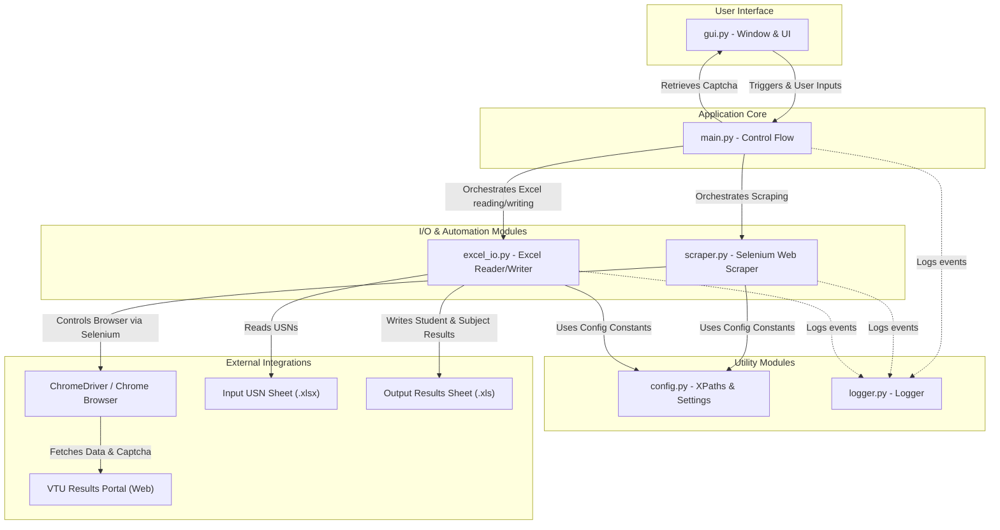

# VTU Result Analysis / Student Result Automation

A Python-based desktop automation tool to fetch student results from the VTU results portal and export them into an Excel sheet for department-level analysis.

This project was originally built and used across multiple departments in my college to automate result retrieval and reduce manual effort by 90%.

---

## 🚀 Tech Stack & Skills Used

- **Python**
- **Tkinter** – Desktop GUI
- **Selenium** – Browser automation
- **Excel automation**
  - `openpyxl` for reading `.xlsx`
  - `xlwt` for writing `.xls`

---

## 📌 What This Tool Does

- Reads student USNs from an Excel file
- Opens the VTU results website in Google Chrome
- Submits USNs and fetches:
  - Student name
  - Subject-wise IA (Internal assessment), SEE (Semester End Exam), TOTAL marks
  - Pass/Fail status
- Exports the collected data into an Excel `.xls` file

---

## Architecture

The project is split into separate files to keep the interface, scraping logic, Excel reader/writer, and settings organized.

### Architecture Diagram



### Module Roles

- **[main.py](file:///c:/Users/samar/Desktop/software-development/portfolio-projects/vtu-result-analysis/src/main.py)**: The main script that runs the app. It launches the UI, reads user inputs, starts the web browser, loops through each student number to get results, and writes the data to the Excel sheet.
- **[gui.py](file:///c:/Users/samar/Desktop/software-development/portfolio-projects/vtu-result-analysis/src/gui.py)**: Creates the Tkinter window. It takes settings like file paths and rows from the user, and pops up a dialog box to ask for the captcha when needed.
- **[scraper.py](file:///c:/Users/samar/Desktop/software-development/portfolio-projects/vtu-result-analysis/src/scraper.py)**: Controls the Google Chrome browser using Selenium. It types in student numbers, enters the captcha, extracts name and marks from the page using XPaths, and closes the result tab when done.
- **[excel_io.py](file:///c:/Users/samar/Desktop/software-development/portfolio-projects/vtu-result-analysis/src/excel_io.py)**: Handles Excel files. It reads student numbers from the input spreadsheet and writes marks, names, and pass/fail highlights to the output spreadsheet.
- **[config.py](file:///c:/Users/samar/Desktop/software-development/portfolio-projects/vtu-result-analysis/src/config.py)**: Stores selectors (XPaths) to find elements on the VTU website, timing delays, and output spreadsheet column positions.
- **[logger.py](file:///c:/Users/samar/Desktop/software-development/portfolio-projects/vtu-result-analysis/src/logger.py)**: Sets up basic logging so that application messages are printed to both the terminal and `app.log`.

---

## ⚠️ Important Notes

- The VTU portal uses a **captcha**, so full automation is not possible.
- In the current version, the captcha must be entered **manually via the terminal/console** when prompted.
- The tool relies on VTU(Visevesvaraya Technological university, Karnataka, India) website structure (XPath selectors).  
  If the website layout changes, the selectors may need to be updated.
- **Do not upload real student data** (USNs, names, results) to GitHub.  
  Use only anonymized or dummy data for testing.

---

## 🛠️ Setup Instructions

### 1️⃣ Install Dependencies

From the repository root:

```bash
pip install -r requirements.txt
```

### 2️⃣ ChromeDriver Setup

This tool requires ChromeDriver.

- Download ChromeDriver matching your installed Chrome version from [ChromeDriver Downloads](https://chromedriver.chromium.org/downloads)
- Provide the ChromeDriver path through the GUI

---

## ▶️ How to Run

From the repository root:

```bash
python src/main.py
```

---

## 🖥️ How to Use the Application

### GUI Inputs

- **CHROMEDRIVER PATH**  
  Select the path to `chromedriver.exe` (Windows) or the ChromeDriver binary.

- **USN FILE PATH**  
  Select an Excel `.xlsx` file containing USNs in Column A.

- **WEBSITE ADDRESS**  
  Paste the VTU results portal URL.

- **SAVE PATH**  
  Choose the output file path and name (Excel `.xls`).

- **USN START (Row) and USN END (Row)**  
  Specify the row range in the input Excel file to process.

Click **SUBMIT** to start automation.

### Captcha Handling

- When prompted in the terminal, manually enter the captcha displayed in the browser.
- The same captcha is reused for processing the selected range.

---

## 📤 Output

Generates an Excel `.xls` file containing:

- USN
- Student Name
- Subject-wise IA, SEE, TOTAL marks
- Result status (P/F)

---

## 🗺️ Planned Improvements

- [x] Refactor code into multiple modules (GUI, scraping, export)
- [x] Move captcha input fully into the GUI
- [ ] Add anonymized sample input/output files
- [ ] Improve GUI layout and styling
- [ ] Improve error handling and robustness

---

## 👤 Authors

**Samarth Kashyap**

Original project developed during undergraduate studies (Department of CSE)

Currently pursuing a Master's degree in Computer Science at RPTU Kaiserslautern, Germany

---

## 📄 License

This project is shared for educational purposes.

---

## 🤝 Contributing

Contributions, issues, and feature requests are welcome!

Feel free to check the issues page if you want to contribute.